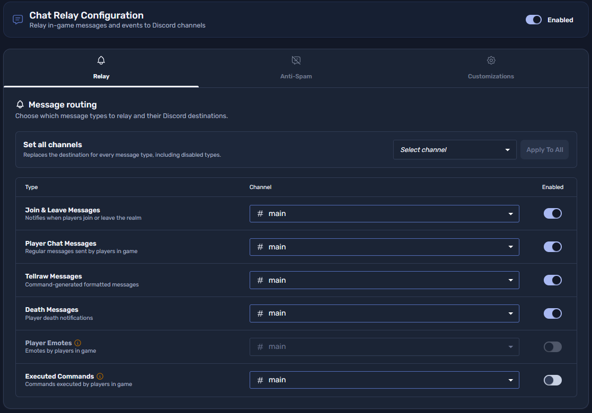

# Chat Relay

Chat Relay connects Minecraft Bedrock Realm chat with Discord. Players can send messages in either direction.

---

## What Chat Relay Relays

Choose which Realm events to send to Discord:

- **Player Chat Messages** - standard messages sent by players in Realm chat
- **Tellraw Messages** - command-generated formatted outputs (announcements, scripted events, systems output)
- **Death Messages** - player death notifications for gameplay visibility and moderation review
- **Player Emotes** - player emotes performed in-game (useful for social visibility and activity context)
- **Player Join and Leave Messages** - connection notices, with optional platform and Realm identification
- **Connection Notices** - configurable connection messages and disconnection warnings

> **Note:** Chat Relay is a communications utility. It does not independently "secure" or "protect" a Realm. All relayed content remains subject to your Realm rules and Discord policies.

---

## Discord-to-Realm Messages

Messages sent in the configured player-chat channel can also be forwarded into the Realm. The sender's Discord display name and message are included in the in-game output.

- Users who can send messages in the relay channel may be able to communicate with players in the Realm.
- Message attachments are not forwarded; send important text as part of the message body.
- Realm Bot's slash-command role permissions do not secure ordinary messages posted in this channel.

Restrict the relay channel to the intended community or staff audience and apply normal Discord moderation controls.

---

## Leveling System Integration

In-game chat activity can contribute to the **Leveling System** alongside time spent online.

When Leveling is enabled and the Realm connection is operational:

- An eligible player message awards between **15 and 25 XP**.
- A player can receive chat XP at most **once per minute**.
- The Relay Account does not receive XP.
- Accumulated XP contributes to the player's level, rank, and leaderboard position.

The Chat Relay output toggle does not independently govern Leveling XP. The **Leveling System** must be enabled and Realm Bot must be receiving the Realm's live chat events through a connected Relay Account.

> **Important:** Chat XP is designed to recognise normal participation, not encourage spam. Chat Relay Anti-Spam controls, Realm moderation rules, and Discord policies still apply.

---

## Requirements

- A Realm connected to Realm Bot via the authorised account-linking flow
- An active Realm Bot Premium subscription
- A Relay Account connected to and present in the Realm
- A Discord destination channel for each enabled message category
- A working Realm Bot GameTest Pack when relaying player emotes

Chat Relay may temporarily stop during Realm disconnections or Microsoft/Xbox authentication failures. See [Relay Account and GameTest Dependencies](relay-account-and-gametest.md) for dependency guidance.

---

## How to Set Up

1. Open the **Chat Relay** module inside the Realm Bot Dashboard.  
   

2. Enable **Chat Relay** using the main toggle.

3. Set a **Discord Destination** for each message category you enable. **Set all channels** fills the individual destinations with the same channel; you can still choose separate channels.

4. Under **Message Types**, enable the categories you want relayed:
   - Player Chat Messages
   - Tellraw Messages
   - Death Messages
   - Player Emotes
   - Player Join and Leave Messages

5. Review **Customisation** settings for system messages, join messages, device identification, and Realm identification.

6. Select a **Fun Mode** only if you want player-chat presentation altered.

---

## Tellraw Translations

Use **Chat Relay > Customizations > Tellraw Message Customizations** for the selected Realm to change how Tellraw translation keys appear **in Discord**. This does not translate ordinary chat or change a player's game language. Chat Relay must be operational, with **Tellraw Messages** enabled and a Discord destination selected.

- **Add translation:** Enter the key used by the Minecraft message and the text to display in Discord. For example, the language-file entry `myrealm.welcome=Welcome back, %s!` only affects messages that use `myrealm.welcome`.
- **Import file:** Select a `.lang`, `.mcpack` or `.zip` file. For a pack, select one of its `texts/*.lang` files, then choose **Import language**. The languages available depend on the pack.

Manual entries override imports, and custom entries override bundled English. Removing an override restores the next available translation. If the top-level key is unknown, Discord displays its identifier.

| Limit | Maximum |
|---|---:|
| Upload | 10 MiB |
| Language files per pack | 100 |
| Selected extracted file | 5,242,880 characters |
| Dictionary entries | 50,000 |
| Key / value | 512 / 16,000 characters |

If an entry is rejected, check for a duplicate manual key. If another session saved changes first, reload the dictionary before editing again.

---

## Anti-Spam Configuration

Set two values to limit repeated player chat:

- **Message Threshold** - the maximum number of messages allowed before the system triggers
- **Window (seconds)** - the time window used to count messages

For example, a threshold of **10** and a window of **10 seconds** allow ten messages within that window. An eleventh exceeds the threshold.

When the threshold is exceeded, the affected player is removed from the Realm and the action is logged. Players on the Realm Bot allowlist are exempt from this anti-spam action.

Operational guidance:
- Start conservative for public communities (e.g., 10-15 messages in 10-15 seconds)
- Increase thresholds for high-volume servers where relay spam is expected during events
- Pair anti-spam with Discord slowmode if your relay channel is public-facing

> **Important:** Setting threshold/window to extremely low values can suppress legitimate activity. Tune this gradually based on real traffic.

---

## Fun Mode

Fun Mode changes how relayed player-chat messages are presented in Discord. Available modes are:

- **Normal** - relays the message without a themed transformation
- **UwU** - applies an UwU-style transformation
- **Pirate** - applies a pirate-style transformation

Use **Normal** for moderation or archival channels where preserving the original wording is important.

---

## Player Emotes

Enable **Player Emotes** to send in-game emotes to Discord. Unlike ordinary player chat, emotes require the **Realm Bot GameTest Pack** as well as a connected Relay Account.

---

## Recommended Configuration

- Use a dedicated channel such as `#realm-chat`, `#chat-relay`, or `#realm-live`.
- Enable only the message types you actually need:
  - Public communities: **Player Chat** + (optional) **Death Messages** + (optional) **Emotes**
  - Staff operations: **Player Chat** + **Tellraw** (systems/events), usually without Emotes
- Enable **Anti-Spam** if your Realm experiences bursts of activity or repeated disruption attempts.
- Treat the relay channel as an extension of in-game chat; enforce the same rules.

---

## Discord Permissions

Realm Bot must have these permissions in the destination channel:

- **View Channel**
- **Send Messages**
- **Read Message History**
- **Embed Links**

If relay output does not appear, channel permissions should be the first thing verified.

Discord users also need **Send Messages** in the player-chat destination to send messages into the Realm. Grant that permission only to the intended audience.

---

## Troubleshooting

### Nothing is relaying

Check the following in order:
- Chat Relay is enabled for the correct Realm
- A destination channel is selected for the affected message category
- Realm Bot has View Channel + Send Messages permission
- The Relay Account is online and connected to the correct Realm
- For emotes, the GameTest bridge is current and responding

### Relay is too noisy

- Disable **Emotes**
- Enable **Anti-Spam** with a moderate threshold/window
- Consider Discord slowmode
- Restrict who can speak in the relay channel (if Discord -> Realm relaying is enabled in your setup)

### Messages appear delayed or inconsistent

- Confirm the Realm is stable and the relay account/session is not disconnecting
- Ensure the anti-spam threshold is not suppressing legitimate output during normal use
- Reconnect the Microsoft/Xbox account if its authentication has expired

### Discord messages do not reach the Realm

- Confirm the message is being sent in the configured player-chat destination.
- Confirm the Relay Account is online.
- Check that the message contains text; attachments alone are not forwarded.
- Confirm the Discord user has permission to send messages in the channel.

---
