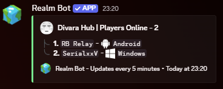
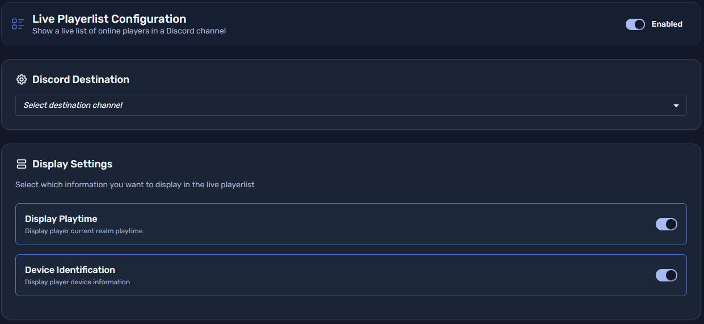

# Live Playerlist

Live Playerlist shows who's online in a Realm in one Discord message. Realm Bot updates it every **five minutes** and creates a replacement if the original message is unavailable.

It requires an active Realm Bot Premium subscription and a connected Relay Account. The GameTest Pack and Beta APIs are not required.

---

## Example Output

Each entry shows a gamertag, optionally with total playtime and device type.

---

## Configuration

In **Realm Modules**, enable **Live Playerlist** for the selected Realm. Under **Discord Destination**, select a channel such as `#players-online`.

Ensure the bot has:
- **View Channel**
- **Send Messages**
- **Embed Links**
- **Read Message History**

### Display Settings

- **Display Playtime** shows the player's recorded total across sessions, not the length of the current session.
- **Device Identification** shows the platform, such as Android, Windows or a console, when it can be detected.

For a read-only player list, restrict who can post in the destination channel.

---

## Troubleshooting

### The playerlist does not appear

- Confirm Live Playerlist is enabled in the module.
- Confirm a Discord Destination channel is selected.
- Verify permissions: View Channel, Send Messages, Embed Links, and Read Message History.
- Confirm the Relay Account is connected to the selected Realm.

### The playerlist is not updating

- Updates occur every 5 minutes; wait for the next cycle.
- Confirm the bot remains online and has access to the destination channel.
- Reconnect the Microsoft/Xbox account if authentication has expired.

### Device/playtime fields are missing

- Ensure the corresponding Display Settings toggles are enabled.
- Some fields may depend on what information is available from the Realm at the time of update.

---
