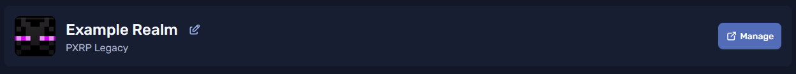
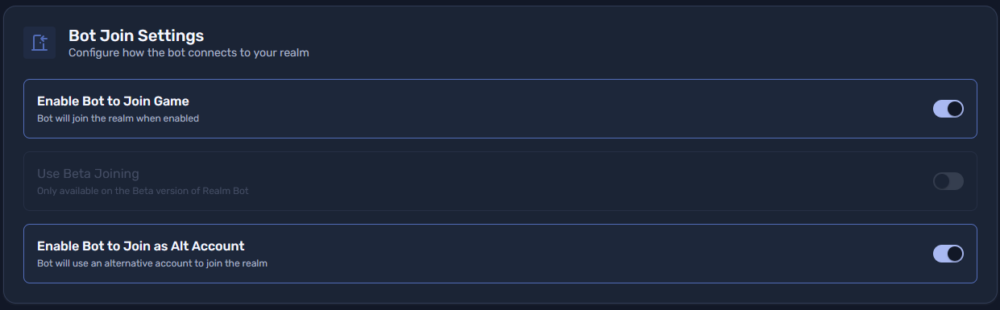
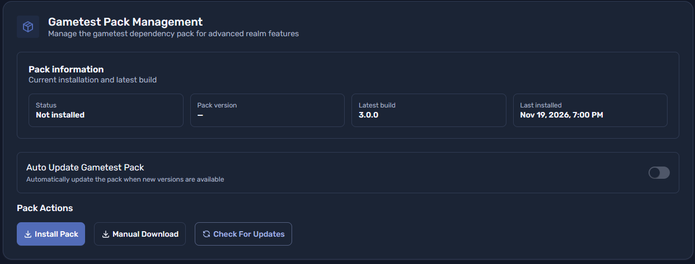
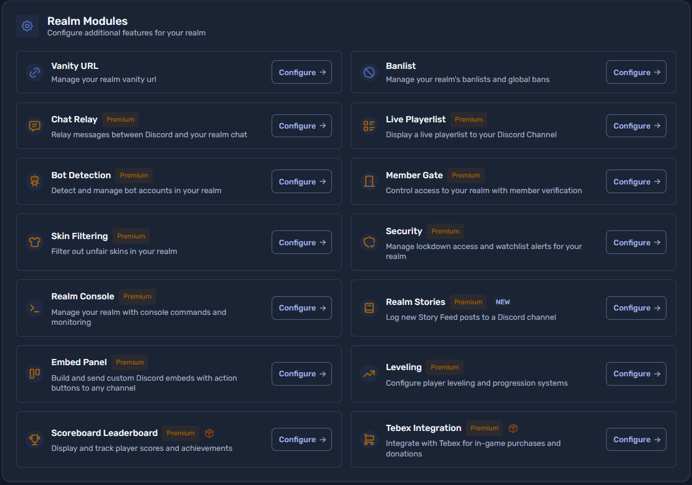

# Overview

Use the selected Realm's dashboard to configure bot joining, install the GameTest Pack and enable modules.

---

## Manage Your Realm

Check the name on the Realm card, then select **Manage**.

---

## Bot Join Settings

Choose how the Relay Account joins this Realm.

- **Enable Bot to Join Game**  
  Allows Realm Bot (via the Relay Account) to join your Realm when required by features that depend on an in-game executor.

- **Use Beta Joining**  
  Uses an experimental joining method (disables the standard joining method). This should only be enabled if instructed or if standard joining is not functioning reliably in your environment.

- **Enable Bot to Join as Alt Account**  
  Allows Realm Bot to join using an alternative account. This is commonly used when your primary Relay Account must remain reserved for specific workflows or when redundancy is required.

> **Important:** Many modules (for example, Chat Relay, Realm Console, Bot Detection, Member Gate, Skin Filtering, and Realm Security) require an in-game Relay Account to perform actions or receive live events. If the bot is not in-game, these modules may not function.

An active Realm Bot Premium subscription is required for the connected Relay Account workflow. Connection-dependent features may pause during Realm disconnections or Microsoft/Xbox authentication failures.

---

## GameTest Pack Management

Install the GameTest Pack for features that need in-game scripting, such as scoreboard retrieval.

- **Auto Update GameTest Pack**
  Installs an available update when Realm Bot next joins the Realm. This is not a continuous background update.

- **Pack Actions**
  - **Install Pack** - installs the dependency pack into the Realm
  - **Update Pack** - installs the latest available version
  - **Remove Pack** - removes the managed pack
  - **Manual Download** - provides a download option for manual deployment workflows
  - **Check For Updates** - checks whether a newer pack version is available

> **Note:** If a module is not behaving as expected and it depends on Gametest, first confirm the pack is installed, enabled, and current.

See [Relay Account and GameTest Dependencies](relay-account-and-gametest.md) for installation requirements and the feature dependency matrix.

---

## Realm Modules

Select **Configure** beside the module you want to change.

- **Bot Detection** - mitigation for malicious bot accounts, including an Experimental mode for stricter detection
- **Chat Relay** - a two-way chat bridge with category-specific channels, custom messages, Fun Mode, and Anti-Spam
- **Leveling System** - chat and online-activity XP with persistent rankings and configurable announcements
- **Live Playerlist** - automatically publish and refresh a Discord view of which players are online
- **Member Gate** - rule-based entry moderation using device, gamerscore, social metrics, and private-title-history checks
- **Realm Console** - run Minecraft commands through a secured Discord console channel
- [Realm Security](realm-security.md) - configure Lockdown access restrictions and Watchlist join alerts under **Automod > Security**
- **Scoreboard Leaderboards** - publish in-game scoreboard rankings to Discord
- **Skin Filtering** - detect and remove players using irregular or exploit-oriented skins
- **Vanity URL** - create a branded, stable invite entry point for your Realm

Also see:

- [Relay Account and GameTest Dependencies](relay-account-and-gametest.md) for shared operational requirements
- [Tebex](../Integrations/tebex.md) for store fulfilment
- [Embed Panel](../Tools/embed-panel.md) for persistent Discord panels with link or Realm-action buttons
- [Realm Stories](../Tools/realm-stories.md) for sharing new Story Feed posts and supported events in Discord without an in-game Relay Account

> **Operational Guidance:** Restrict access to high-impact modules (such as Realm Console, Member Gate, Skin Filtering, and Realm Security's Lockdown) to trusted administrators. These features can directly affect gameplay, player access, and server stability.

---

## Recommended Setup Order

1. Confirm you are managing the correct Realm (top card).
2. Configure **Bot Join Settings** to ensure reliable in-game connectivity.
3. If required, install and validate the **GameTest Pack** (and enable Beta APIs where prompted).
4. Enable and configure the modules you intend to use.
