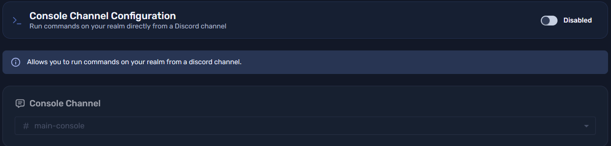

# Realm Console

Messages posted in the **Realm Console** Discord channel run as Minecraft Bedrock commands through the in-game **Relay Account**. Its permissions and position determine what those commands can do.

## Command Example

For example, sending `gamemode c @a` in the console channel attempts to put **every player** in Creative mode.

## Relay Account Behaviour and Targeting

`@s` targets the Relay Account, not the Discord user who posted the command. Commands without an explicit target can also affect the Relay Account.

> **Important:** When running player-specific commands, always specify explicit targets (for example `@a`, `@p`, a username, or a tagged group) to avoid unintended effects on the Relay Account.

## Requirements

- A configured **Relay Account** connected in-game.
- An active Realm Bot Premium subscription.
- Sufficient in-game operator and command privileges for the intended commands.
- A designated Discord channel selected as the Realm Console.

## Access Control and Security

Anyone who can post in the console channel can attempt to run commands with the Relay Account's authority. Slash-command role permissions do not restrict these messages.

- Restrict viewing and posting to trusted administrators.
- Never configure the Realm Console in a publicly writable channel.

Failure to secure this channel may result in:
- Abuse of commands
- Griefing actions
- Unauthorised administrative changes
- Accidental disruption through misuse

## Syntax Errors and Safe Usage

Minecraft treats every console message as a command. Keep conversation in another channel. If a command fails, check its Bedrock syntax and selectors.

## Recommended Operational Practices

- Use a dedicated channel such as `#realm-console` or `#console`.
- Limit access to a small set of trusted staff.
- Encourage staff to test complex commands in a controlled environment before running them in production.
- Prefer targeted commands (`@a`, tags, usernames) over ambiguous or executor-dependent commands.

If you require assistance configuring the Realm Console for your Realm, open a support ticket and include:
- The Realm name
- The console channel name
- Confirmation that the Relay Account is in-game
- A sample command that is failing and the resulting error output (if any)
