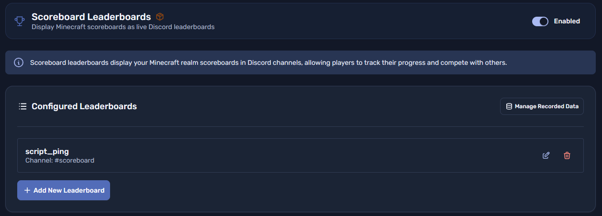
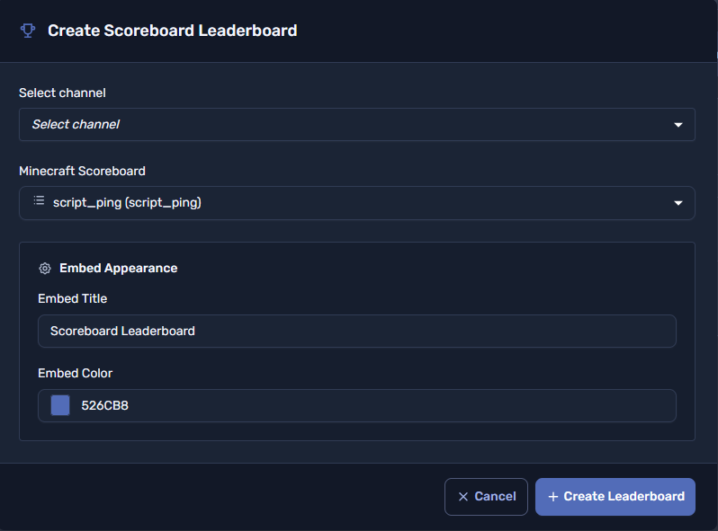

# Scoreboard Leaderboards

Publish the rankings for a Minecraft scoreboard objective in a Discord channel. Each leaderboard has its own objective and destination.

## How it Works

- Realm Bot retrieves scoreboard values approximately **once per minute** and updates the embed.
- You can configure up to **10 leaderboards**, each showing up to **10 entries**.
- Realm Bot edits the existing Discord message where possible and recreates it if that message is no longer available.

> **Important:** This feature is dependent on the Realm runtime environment. If the required in-game components are not active, leaderboards cannot update.

## Requirements

- The **Relay Account** to be actively **in-game**.
- The **Realm Bot GameTest Pack** installed and current.
- An active Realm Bot Premium subscription.
- At least one valid in-game **scoreboard objective** to display.

## How to Set Up

1. Open the **Scoreboard Leaderboards** module in the Realm Bot Dashboard and enable it.
   
2. Select **Create Leaderboard**.
3. Configure the leaderboard using the creation menu.
   
4. Set the following:
    - **Select channel** - the Discord channel where the leaderboard should be displayed.
    - **Minecraft Scoreboard** - the scoreboard objective to publish.
5. (Optional) Customise the embed appearance:
    - **Embed Title** - the label shown at the top of the embed.
    - **Embed Colour** - the accent colour used for the embed.
6. Save the leaderboard configuration.

Realm Bot requires **View Channel**, **Send Messages**, **Embed Links**, and **Read Message History** in each destination channel.

## Recommended Usage

Scoreboard Leaderboards are ideal for:
- Factions / prisons progression metrics
- Kills, deaths, K/D tracking (where implemented via scoreboards)
- Event wins, captures, or objective scoring
- Currency or point systems tracked via scoreboard objectives

Operational recommendations:
- Use a dedicated channel such as `#leaderboards`, `#stats`, or `#rankings`.
- Keep one leaderboard per channel unless you have a structured layout (multiple leaderboards in one channel can become difficult to read).
- Use clear embed titles aligned with your scoreboard objective name (for example: “Top Kills”, “Top Balance”, “Top Wins”).

## Troubleshooting

### The leaderboard shows no entries
- Confirm the selected scoreboard objective exists in-game and contains values.
- Ensure the Relay Account is online in the Realm.
- Verify the Realm Bot GameTest Pack is installed and current.

### The leaderboard is not posting to Discord
- Confirm the bot has permission to **View Channel**, **Send Messages**, **Embed Links**, and **Read Message History** in the selected channel.
- Verify the correct channel was selected during setup.

### The scoreboard name is not appearing in the dropdown
- The scoreboard objective may not be created in-game yet, or the environment may not be detectable if the required pack/account is offline.
- Create or validate the scoreboard in-game, then refresh the dashboard and try again.
- Confirm the Relay Account is connected and the GameTest bridge is responding.

## Best Practices

- Treat leaderboard channels as read-only where possible to keep output clean.
- Standardise scoreboard objective naming in-game to reduce confusion in the dashboard.
- If you are using leaderboards competitively, ensure your scoreboard values cannot be trivially manipulated by players.
