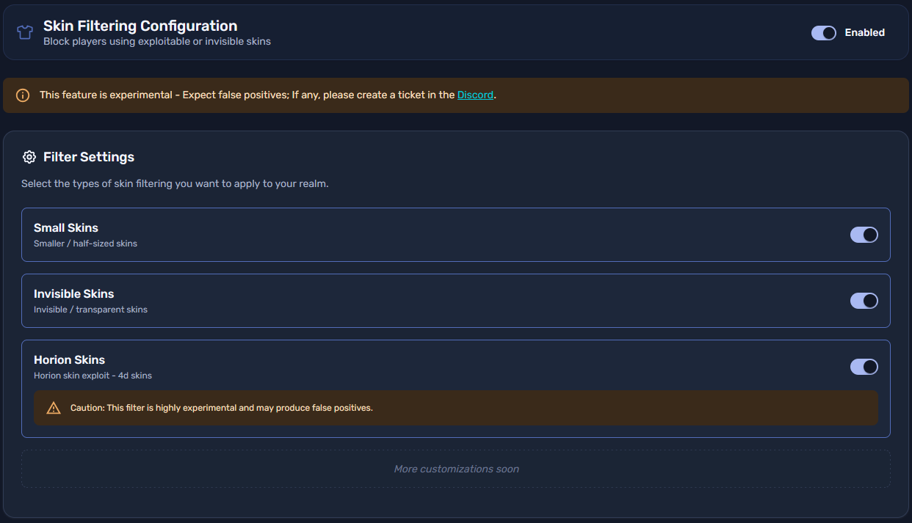
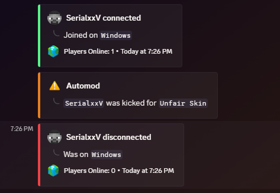
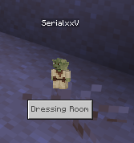

# Skin Filtering

Skin Filtering removes players whose skins match a category you have blocked, such as invisible or half-sized skins.

Skin Filtering is currently a **Beta** feature. Some false positives may occur depending on the skin type and platform behaviour.

---

## Requirements

- The Realm Bot **Relay Account** to be **in-game**
- Skin Filtering enabled within the Realm's modules section
- An active Realm Bot Premium subscription

The GameTest Pack is not required for Skin Filtering. Players on the Realm Bot allowlist are intended to bypass filtering.

---

## Filter Settings

Enable only the categories your Realm rules prohibit.

### Small Skins

Detects skins that make a player appear smaller than normal, including half-sized skins.

### Invisible Skins

Detects invisible or transparent textures that make a player difficult to see.

### Horion Skins (4D Skins)

Filters "4D" or Horion-style skins commonly associated with exploit clients and cosmetic manipulation.

---

## What Enforcement Looks Like

When a player is detected using a disallowed skin type, Realm Bot removes the player with the reason **Unfair Skin** and records the outcome in the configured Automod channel.

---

## Example Context: Small Skin in Use

A small skin can make a player harder to spot in PvP.

---

## When to Enable Skin Filtering

Consider filtering on public or competitive Realms where visibility affects play. A private Realm may not need it unless players use prohibited skins.

---

## Best Practices

- Start with the most clear-cut filters first (typically **Invisible Skins** and **Horion/4D Skins**).
- Monitor for false positives during the first few days of use.
- Publish a short rule statement to players (e.g., "Invisible/4D skins are not allowed.").
- Maintain a staff process for appeals if a legitimate player is incorrectly removed.

---

## Beta Notes and False Positives

If you observe false positives:
- disable the category most likely to be causing false positives first
- enable one filter at a time to isolate the cause
- log affected gamertags and timestamps for support review

---

## Troubleshooting

### Filtering is enabled, but nothing happens

- Confirm the Relay Account is **in-game**
- Confirm Skin Filtering is enabled for the correct Realm
- Ensure at least one filter category is toggled on
- Confirm the player is not on the Realm Bot allowlist

### Legitimate players are being removed

- Disable the most aggressive category first (commonly 4D/Horion)
- Re-test with a smaller scope (enable one filter at a time)
- Treat early Beta enforcement as reviewable until detection stabilises
- If an allowlisted player is affected, record the gamertag and timestamp and contact support

---
