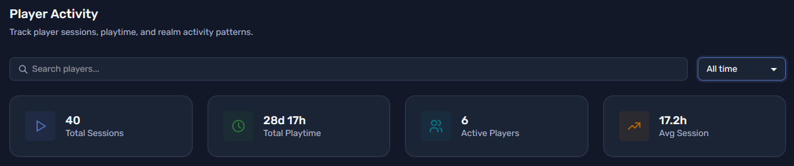
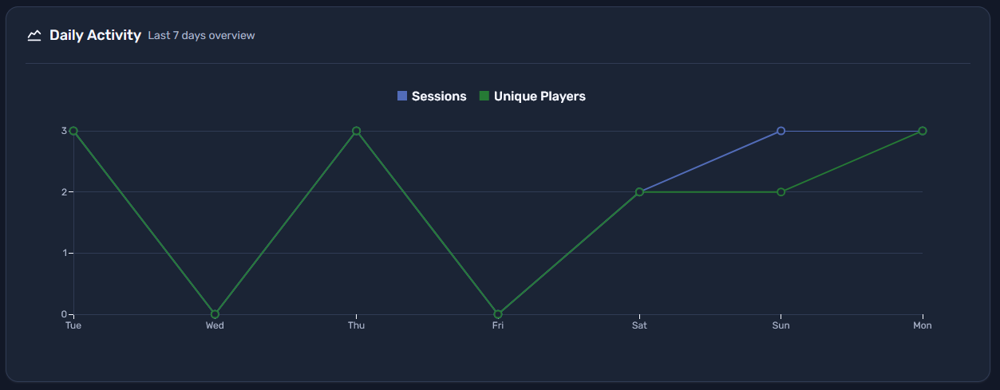
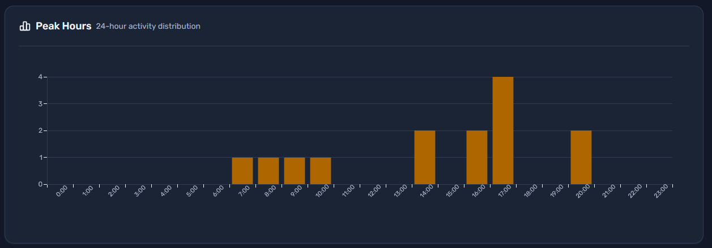
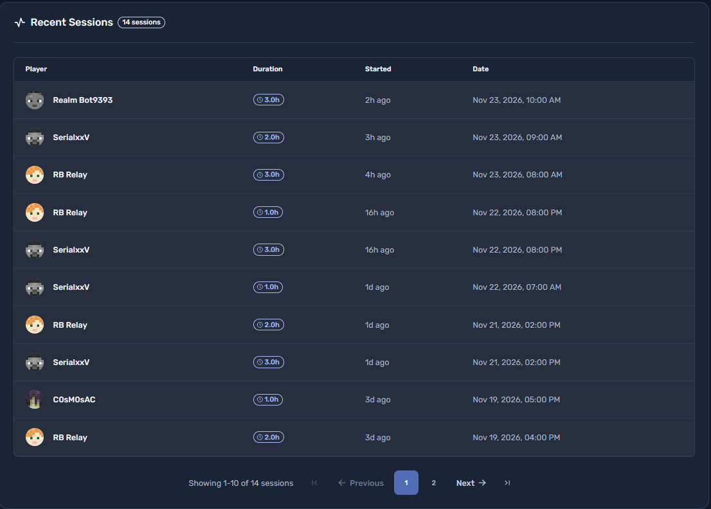

# Realm Activity

Use **Realm Activity** to see who played, how long they stayed and which hours were busiest.

---

## Overview and Time Range

Select a time range, such as **Last 7 days**, for the charts and totals:

- **Total Sessions** - total number of recorded play sessions
- **Total Playtime** - cumulative playtime across all sessions
- **Active Players** - number of unique players active in the selected period
- **Average Session** - average session duration during the selected period

---

## Player Search and Filtering

Search by player to check when an account was online during an incident.

---

## Daily Activity

Compare two counts for each day:

- **Sessions** - how many sessions occurred per day
- **Unique Players** - how many distinct players were active per day

---

## Peak Hours

**Peak Hours** groups activity by hour of day. Use the busiest hours to plan staff coverage.

> **Operational Tip:** If you notice repeated activity spikes at a consistent hour block, consider scheduling maintenance or updates outside those windows to minimise disruption.

---

## Recent Sessions

Check a player's session duration and start time. **Started** shows a relative time; use **Date** for the timestamp when comparing a session with an incident report.

---

## Interpreting the Data

- **Short sessions** may indicate quick join-checks, instability, or connection issues.
- **Low unique players with high sessions** may indicate a small group playing frequently.
- **High peak-hour concentration** may suggest a strong time-zone bias in your community.
- **Sudden spikes** can align with public code exposure, events, raids, or content updates.

---

## Troubleshooting Notes

If the page appears empty or incomplete:

- Confirm you are viewing the **correct Realm**.
- Ensure there has been activity within the selected timeframe.
- If your activity system relies on an in-game relay/account presence in your deployment, verify it is operating correctly.
- Try expanding the timeframe to confirm whether older activity exists.

---
