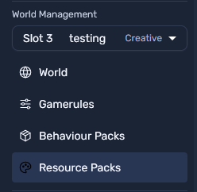
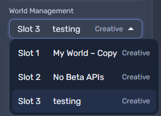
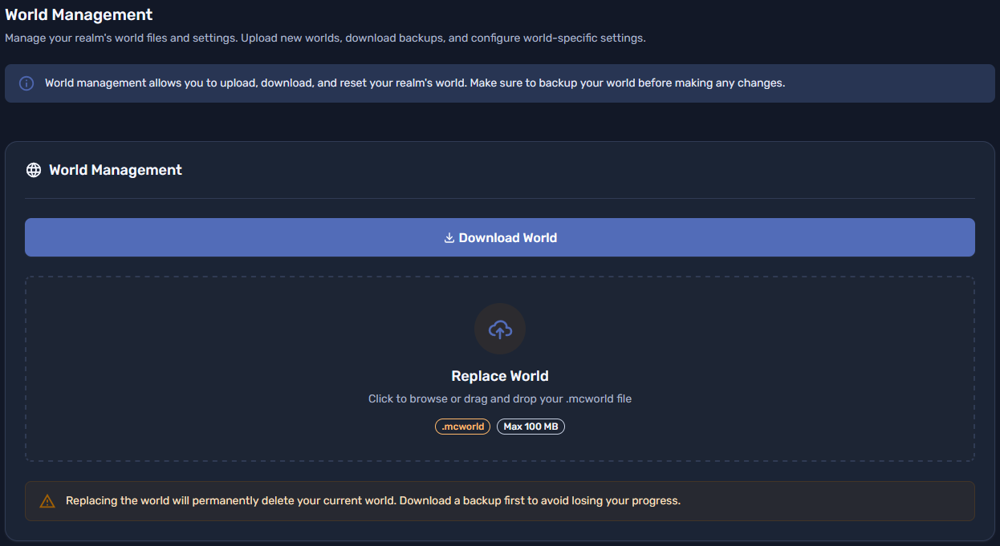
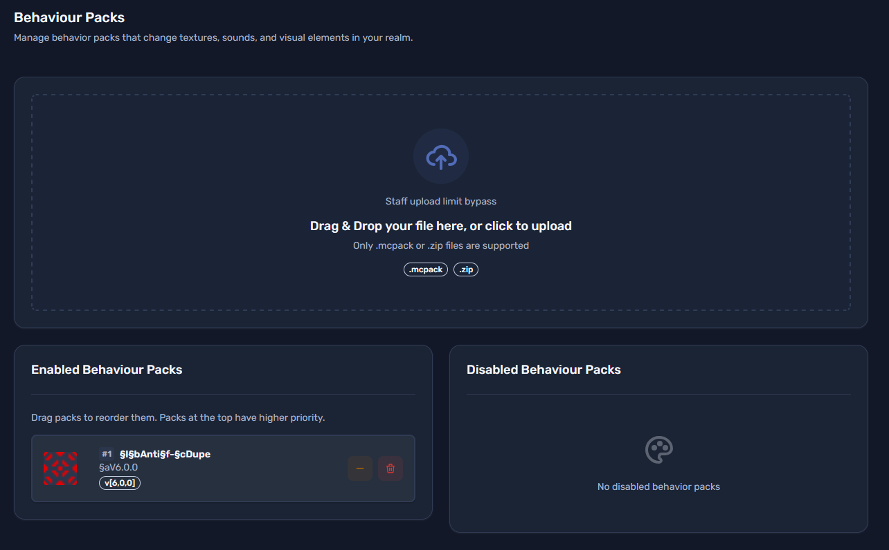
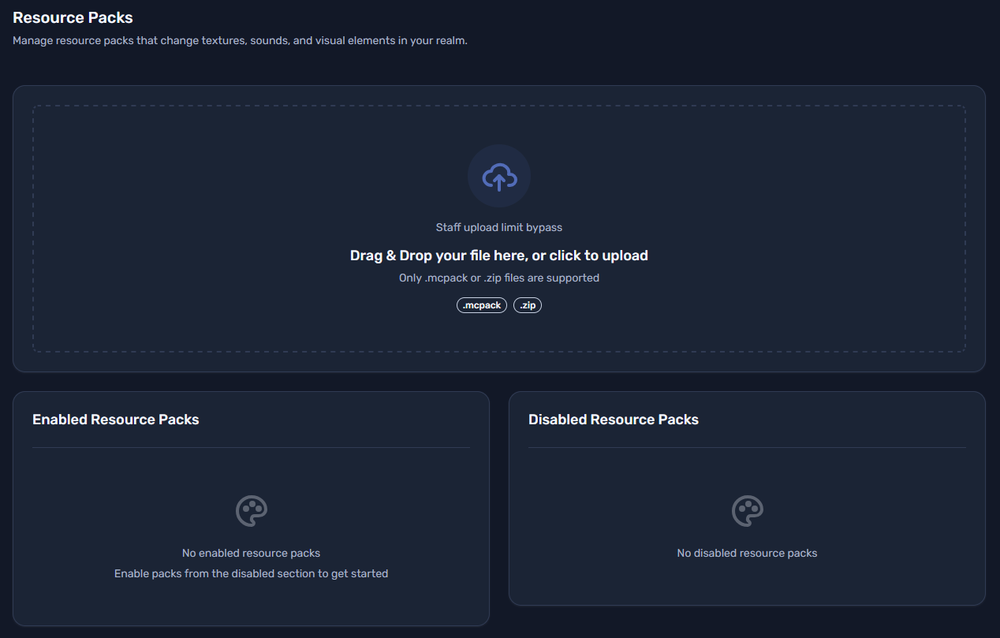

# World Management

Use **World Management** in the Realm manager to work with world files, packs and settings:

1. **World Slot** - choose which of your Realm’s world slots you are managing  
2. **World** - download a backup and replace the active world file  
3. **Behaviour Packs** - upload and manage behaviour packs for the active world  
4. **Resource Packs** - upload and manage resource packs for the active world
5. **Gamerules** - view and edit the rules returned for the active world

> **Important:** All actions in World Management apply to the **currently selected World Slot**. Always confirm you are modifying the correct slot before uploading, replacing, or changing pack order.

---

## World Slot

Use **World Slot** to select slot **1**, **2** or **3**.

Check the slot name and game mode before replacing a world or changing its packs.

**Best practice:** Treat world slots as separate environments. Keep at least one slot reserved for backups/testing if your workflow allows it.

---

## World

### Download World (Backup)
Use **Download World** to export the current world from the selected slot.

This is strongly recommended before you:
- replace the world
- install significant packs
- make major gameplay changes that could require rollback

### Replace World
Replace World allows you to upload a new world file to the active slot.

- Supported file type: **.mcworld**
- Maximum file size: **100MB** (as displayed in the uploader)

> **Warning:** Replacing the world will permanently delete the current world for that slot. Download a backup first to avoid losing progress.

Operational guidance:
- Only replace worlds during low-activity windows.
- Announce downtime to staff/players if the Realm will be unavailable during the swap.
- Verify the correct slot is selected before upload.

---

## Behaviour Packs

Behaviour packs change gameplay, such as entity behaviour and game mechanics.

### Uploading Behaviour Packs
- Supported file types: **.mcpack** or **.zip**
- Maximum upload size: **25 MB** on Free plans or **50 MB** with Premium
- Drag-and-drop is supported, or click to upload.

### Pack Priority

Drag packs in the **Enabled Behaviour Packs** list to reorder them. When packs change the same content, the higher pack takes priority.

### Management Actions
Disable a pack to stop using it on the world, or use the delete action to remove its entry where available.

**Best practice:**
- Introduce packs one at a time and test after each change.
- Keep a record of pack versions used in production.
- If a pack conflicts with another, adjust priority first before removing.

---

## Resource Packs

Resource packs change textures, sounds and other client-side assets.

### Uploading Resource Packs
- Supported file types: **.mcpack** or **.zip**
- Maximum upload size: **25 MB** on Free plans or **50 MB** with Premium
- Drag-and-drop is supported, or click to upload.

Enable the pack for the world after uploading it. If all players must use it, check the world's **Texture pack required** setting.

---

## Gamerules

Open **World Management > Gamerules** and check the world name and **active slot**. You can view the rules with a linked, authorised Xbox account; editing requires game-settings permission.

The editor displays rules supplied by Minecraft; it does not add missing rules or assume default values. Switches cover settings such as PvP, damage, daylight and weather cycles, mob behaviour, inventory, drops and command feedback. Unknown rules, unsupported values and player waypoints are read-only.

| Numeric rule | Accepted range |
|---|---:|
| Random tick speed | 0 to 4,096 |
| Spawn radius | 0 to 128 |
| Sleeping percentage | 0 to 100 |
| Function command limit | 0 to 10,000 |
| Command chain length | 0 to 2,147,483,647 |

Select **Save changes**. If the active slot changed, discard the draft rather than applying it to another world. If another manager edited a rule, a restart is pending or confirmation timed out, refresh and check the current values before retrying. Some changes may already have applied.

---

## Safety and Operational Notes

- **Always download a backup** before replacing a world or making major pack changes.
- **Confirm the active slot** before uploading anything.
- If you run a public Realm, consider applying changes during quiet hours and communicating updates in advance.
- If something breaks after a change, revert by:
  - removing/disabling the most recent pack changes, or
  - restoring a known-good world backup where available.
