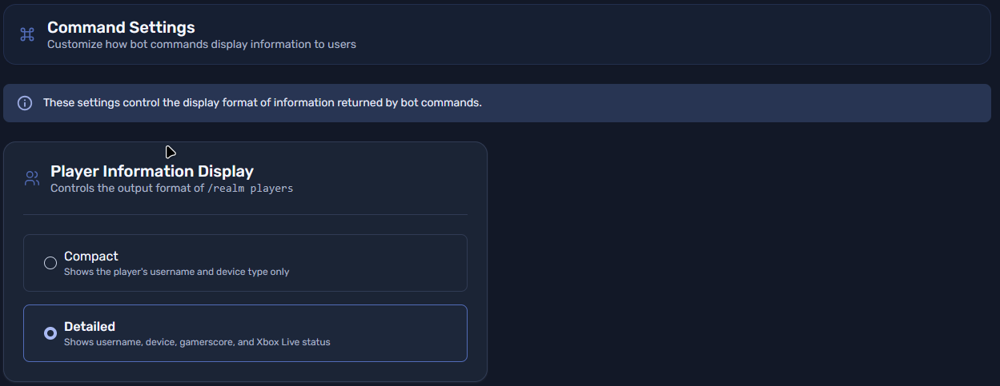

# Command Settings

Choose how much player information Realm Bot shows in Discord commands such as [`/realm players`](../Commands/Realm/players.md).

---

## Player Information Display

| Mode | Information shown when available |
|---|---|
| **Compact Display** | Player name and device type |
| **Detailed Display** | Player name, device type and the player's Minecraft Realm permission |

Use **Compact Display** if staff do not need the extra profile details. Changing the display does not grant command permissions.

---
