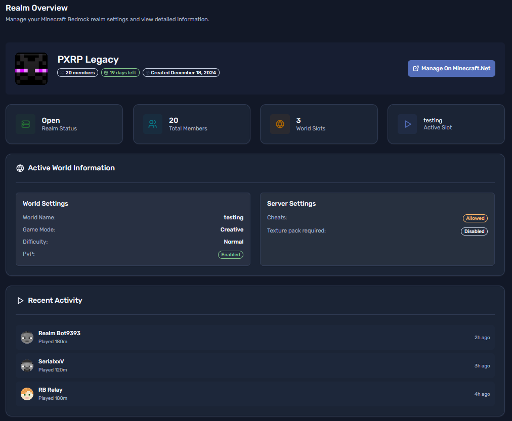

# Realm Overview

Open **Realm Overview** to check whether your Realm is open, which world slot is active and who has played recently.

---

## Realm Summary Card

Use the Realm name and identifier to confirm which Realm you are managing. The card also shows:

- **Realm description** (if set)
- **Member count** (total members associated with the Realm)
- **Time remaining** on the subscription period (if available)
- **Creation date** (Realm creation timestamp)

### Manage on Minecraft
Select **Manage on Minecraft.Net** for subscription management and settings available only through Minecraft.

---

## Quick Status Cards

Check whether the Realm is open, its total membership, the number of world slots and which slot is active. **Total Members** counts members, not players currently online.

---

## Active World Information

### World Settings
- **World Name**
- **Game Mode** (for example, Survival or Creative)
- **Difficulty** (for example, Easy / Normal / Hard)
- **PvP** status (Enabled/Disabled)

### Server Settings
- **Cheats** status (Allowed/Disallowed)
- **Texture pack required** (Forced/Not forced), if configured

> **Important:** Values shown here reflect the **active slot only**. If you switch the active world slot, the displayed values may change accordingly.

---

## Recent Activity

Recent Activity shows account names, session duration when available, and how recently the player was active. For session history, open [Realm Activity](realm-activity.md).

---

## Troubleshooting and Notes

### The page is missing data or looks incomplete
- Confirm the Realm is correctly connected and selected in the dashboard.
- Refresh the page and verify the account linking is still valid.
- Some values are dependent on what the platform exposes at the time of retrieval.

### The Realm status looks wrong
- Realm status can lag slightly behind real-time changes.
- Verify status using official tools if you are troubleshooting an active outage.

### Values do not match what is expected in-game
- Ensure you are viewing the **active world slot** you intend to check.
- If you recently changed settings, allow time for changes to propagate and refresh the page.

---

## Related Pages

- [Getting Started](../setup.md) (initial account linking and connection)
- [Realms Hub](realms-hub.md) (Minecraft Realm settings, members and Admin Logs)
- [Server Performance](server-performance.md) (live metrics and recent history for Minecraft Realms Pro)
- **Bot Join Settings** (how the Relay Account joins)
- **Gametest Pack Management** (required for certain advanced features)
- [Realm Modules](<../Realm Modules/overview.md>) (Chat Relay, Realm Console, Bot Detection, Member Gate, Realm Security, Skin Filtering, Leveling, Scoreboards, Live Playerlist, Vanity URL)
- [Realm Stories](../Tools/realm-stories.md) (Story Feed posts, screenshots, and supported Realm events in Discord)
