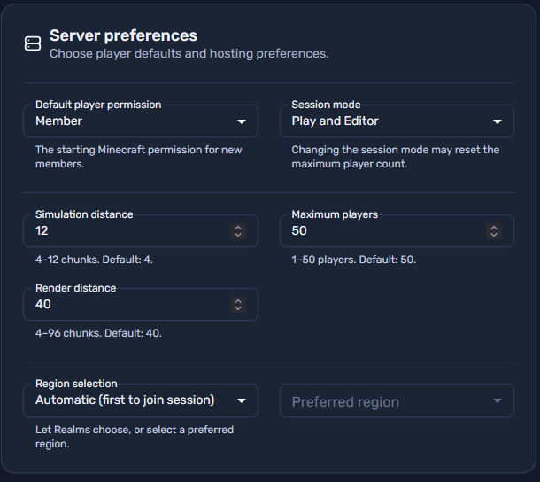
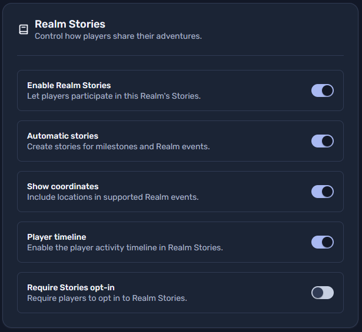
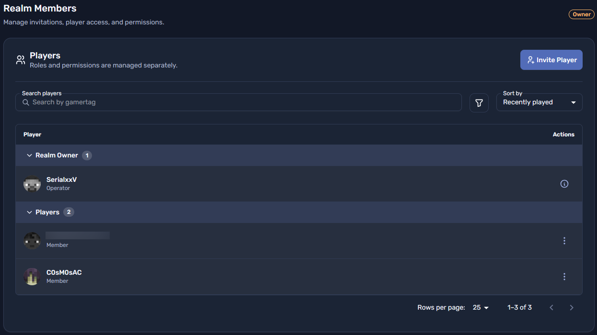
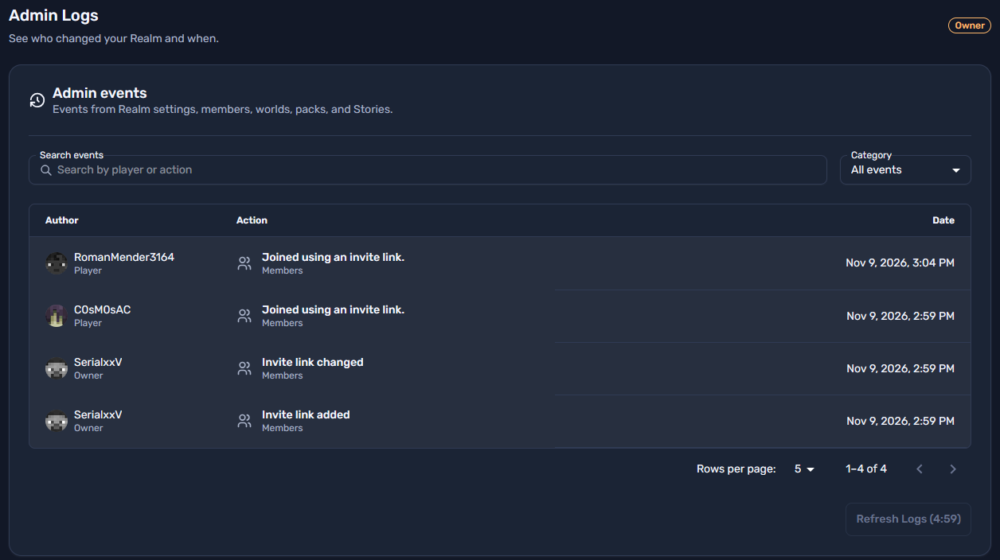

# Realms Hub

Open the **Realm manager > Realms Hub** for the Minecraft Realm you want to manage. The Hub opens on **Settings**. Use **Members** to manage access and **Admin Logs** to review changes. These controls apply to the Minecraft Realm itself, not the Discord server or the Global Ban database.

---

## Who Can Use the Hub?

Sign in with the linked Xbox account that owns the Realm or has been made a **Realm Admin** in Minecraft. The owner has access to all Hub actions. A delegated Admin can use only the actions Minecraft grants them. Being a Discord Administrator does not grant either role.

---

## Server Preferences

Under **Settings > Server preferences**, use the minimum, maximum and default displayed for your Realm. Player counts and distances use whole numbers. Changing these settings requires game-settings permission.

| Setting                   | What to check                                                                                                                                                      |
| ------------------------- | ------------------------------------------------------------------------------------------------------------------------------------------------------------------ |
| Maximum players           | Requires Minecraft **Realms Pro**. Check the value again after changing session mode.                                                                              |
| Simulation distance       | Requires Minecraft **Realms Pro**. Use the range shown for this Realm.                                                                                             |
| Render distance           | Available limits depend on the Realm. Minecraft must supply a valid range before you can change it.                                                                |
| Session mode              | Requires Minecraft **Realms Pro**. Choose **Play and Editor**, **Play Only** or **Editor Only**. Changing mode can reset maximum players.                          |
| Default player permission | Choose the starting permission for new Realm members: **Visitor**, **Member**, or **Operator**.                                                                    |
| Region selection          | Choose **Automatic (first to join session)**, **Automatic (Realm owner connection)**, or **Preferred region** to control how the Realm selects its hosting region. |
| Preferred region          | Only available when Region selection is set to **Preferred region**. Select from the regions provided by Mojang.                                                   |

To restart the Realm on specific days, see [Scheduled Restart](scheduled-restart.md).

---

## Realm Stories

Under \*\*Settings > Realm Stories\*\*, control how players share their adventures and how Realm activity appears in Stories. Changing these settings requires the appropriate Realm management
permissions.

| Setting                | What to check                                                                                 |
| ---------------------- | --------------------------------------------------------------------------------------------- |
| Enable Realm Stories   | Allow players to participate in this Realm's Stories. Disabling this turns off Realm Stories. |
| Automatic stories      | Automatically create stories for player milestones and Realm events.                          |
| Show coordinates       | Include location coordinates in supported Realm events.                                       |
| Player timeline        | Enable the player activity timeline in Realm Stories.                                         |
| Require Stories opt-in | Require players to opt in before participating in Realm Stories.                              |

These settings control Realm Stories for the Realm, not [Realm Stories](../Tools/realm-stories.md) under Tools.

---

## Members

1. Open **Members**. Search for a player or sort by name or last played. Filters include gameplay permission, Realm role, pending invitations and blocked players. When presence information is available, filter by online, playing or offline.
2. To invite someone, enter their gamertag or XUID (Xbox account identifier). To manage an existing entry, select the player and check their identity before changing access.
3. Choose the action for that entry: cancel a pending invitation, remove a member, block or unblock a player, or open **Roles & permissions**.

**Visitor**, **Member** and **Operator** govern in-game permissions. **Player** and **Admin** govern Realm management. Only the owner can change Realm roles. A delegated Admin cannot change the owner or manage another Admin as an ordinary player.

---

## Admin Logs

Open **Admin Logs** to see the actor, action and time, newest first. Search by player or action, or filter by **Settings**, **Members**, **World**, **Packs**, **Stories** or **Other**. For example, use **Members** to investigate an invitation, or **World** when reviewing a slot change.

Manual refresh has a five-minute cooldown. If a refresh fails, the previous results can remain visible; wait for the cooldown and refresh again before treating them as current.

---
