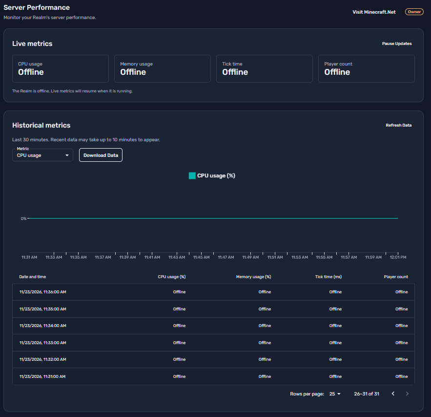

# Server Performance

Use **Realm manager > Overview > Server Performance** to check how the Realm is running. This is separate from [Realm Activity](realm-activity.md), which tracks player sessions and playtime.

You need a linked Xbox account with game-settings permission on a **Minecraft Realms Pro** Realm.

---

## Read Live Metrics

The live cards show **CPU usage (%)**, **memory usage (%)**, **tick time (milliseconds)** and **player count**. They refresh about every ten seconds unless paused. If the Realm is offline, the cards indicate that live data is unavailable, not that usage is zero.

---

## Compare and Download History

1. Open the history chart to view the **last 30 minutes**. CPU is selected initially; select additional metrics to compare them.
2. Refresh the chart manually for newer history. The ten-second live refresh does not refresh this chart, and recent samples can take up to ten minutes to appear.
3. Select **Download data** for a CSV of the returned timestamps and **all four metrics**, even if you selected only one on the chart.

A blank value in the CSV means the measurement is missing. It does not mean zero players or zero usage. For a snapshot of recent history in Discord, use [`/realm perf`](../Commands/Realm/perf.md).

---
