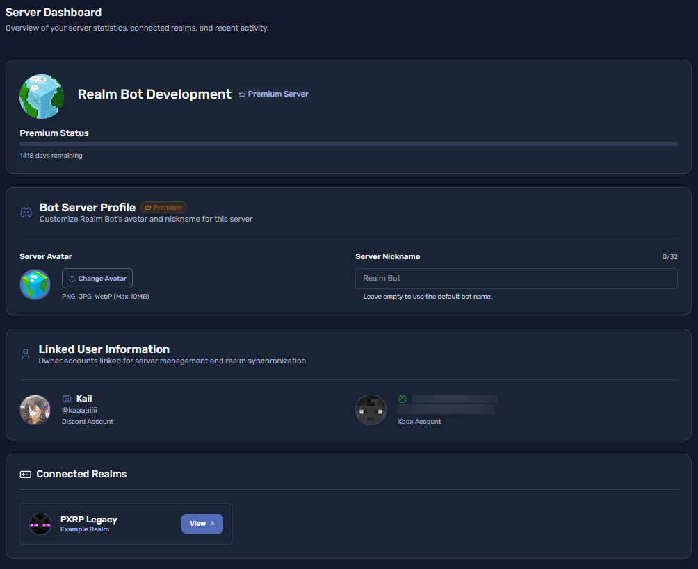
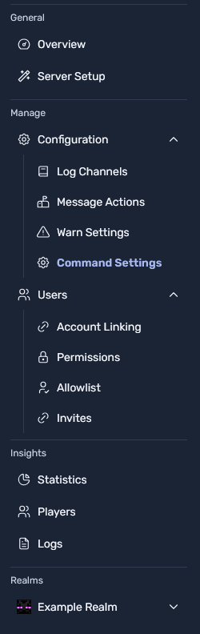

# Server Dashboard

Open your Discord server's **Overview** to check Premium status, verify the linked accounts, or select a connected Realm.

---

## Premium Status

**Premium Status** shows whether Premium is active and how much time remains.

---

## Bot Server Profile

With Premium, use **Bot Server Profile** to change Realm Bot's avatar and nickname for this Discord server.

See [Bot Server Profile](bot-server-profile.md) for supported images, nickname limits, and reset controls.

---

## Bot Updates & Announcements

Choose a Discord channel to receive official Realm Bot announcements. See [Updates Channel](server-setup.md#updates-channel) for subscribing, changing the destination or stopping delivery.

---

## Linked User Information

Check the Discord username and Xbox gamertag. The Xbox account identifier (XUID) may also be shown.

- If a Realm is missing, check that the correct Microsoft/Xbox account is linked.
- Unexpected permissions or access issues can be caused by linking a non-owner account.

---

## Connected Realms

Select **View** beside the Realm you want to manage.

---

## Navigation Sidebar

### Overview
- [Server Setup](server-setup.md) - configure logging, role permissions, warning presets and account linking.

### Manage
- [Log Channels](server-logs.md) - choose Discord destinations for moderation logs.
- [Account Linking](server-account-linking.md) - assign roles or invite verified members to a Realm.
- [Message Actions](server-message-actions.md) - customise the messages players receive after moderation actions.
- [Warn Settings](server-warnings.md) - set warning reasons and ban thresholds.
- [Command Settings](server-command-settings.md) - choose how much player information appears in Discord.
- [Permissions](server-permissions.md) - assign commands to staff roles.
- [Allowlist](server-allowlist.md) - exempt trusted players from automated checks.
- [Moderation Logs](server-mod-logs.md) - review past actions by player or action type.
- [Invite Links](server-invites.md) - create and manage Realm invitations.

### Realms
A list of all connected Realms is shown at the bottom. Selecting a Realm expands its available Realm pages and configuration areas.

---

## Recommended Setup Order

1. Confirm Premium status (if applicable)
2. Verify **Linked User Information** (correct Discord + Xbox account)
3. Confirm your Realms appear under **Connected Realms**
4. Configure **Permissions / Allowlist** before enabling staff tooling
5. Configure **Log Channels** so actions are auditable
6. Proceed into Realm-specific pages for modules and world configuration

---

## Common Issues

### “My Realms are not showing.”
- Ensure the correct Microsoft/Xbox account is linked.
- Re-run the linking flow in **Account Linking** if needed.
- Confirm the account actually owns or has access to the Realms expected.

### “Staff can see things they shouldn’t.”
- Review **Permissions** and **Allowlist** first.
- Restrict high-impact areas to trusted administrator roles only.

### “I can’t access a page from the sidebar.”
- Confirm your role has permission for that section.
- Ensure the bot has the required Discord permissions in the server.

---
