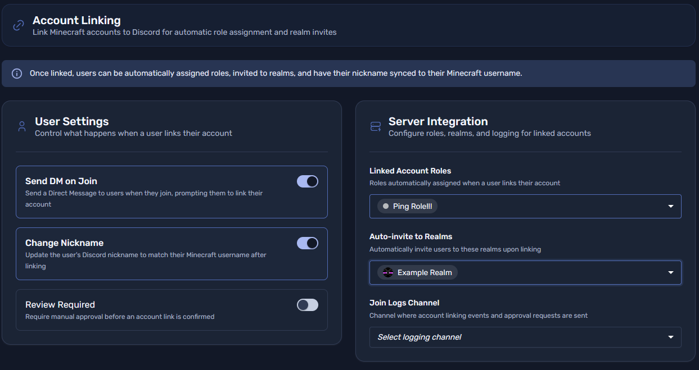

# Account Linking

Account Linking verifies that a Discord member controls the Minecraft account they link.

---

## User Settings

### Account Linking
When enabled, members can link their Minecraft account to Discord using the Realm Bot linking flow.

### Change Nickname
When enabled, Realm Bot will update a user’s **Discord nickname** to match their Minecraft username after linking.

**Before enabling, ensure:**
- Realm Bot has **Manage Nicknames** permission in your Discord server
- Realm Bot’s role is **above** the roles of users whose nicknames it needs to edit (Discord role hierarchy)
- Your server rules allow nickname automation (some communities prefer members to control nicknames themselves)

> **Note:** If permissions or role hierarchy prevent nickname changes, linking can still succeed, but nickname syncing may fail.

---

## Server Integration

### Linked Account Roles
Select one or more Discord roles to automatically assign when a member successfully links.

**Best practice:** Assign only the minimum role(s) needed for access. Keep staff roles manual.

### Auto-invite to Realms
Choose which connected Realm(s) should automatically invite users when they link their account.

**Operational notes:**
- Auto-invite should be limited to trusted Realms (avoid auto-inviting to testing/admin Realms).
- If a Realm is missing from the dropdown, confirm it is connected and visible under your linked Xbox account context.

### Join Logs Channel
Select a Discord channel where Realm Bot will post account linking events (e.g., successful links, key outcomes, and related system messages as supported).

**Recommended setup:**
- Use a staff-only channel (e.g., `#join-logs` or `#verification-logs`)
- Ensure Realm Bot has:
  - **View Channel**
  - **Send Messages**
  - **Read Message History** (recommended)

---

## Recommended Configuration

1. Enable **Account Linking**
2. Set **Linked Account Roles** to a standard member role (e.g., `Member` / `Verified`)
3. Enable **Auto-invite to Realms** only for your primary public/member Realm
4. Set a dedicated **Join Logs Channel**
5. Enable **Change Nickname** only if your staff team wants enforced identity consistency

---

## Troubleshooting

### Roles are not being assigned
- Confirm the selected role exists and is still selected.
- Ensure Realm Bot’s role is **above** the target role(s) in Discord role hierarchy.
- Verify Realm Bot has **Manage Roles** permission.

### Nicknames are not changing
- Ensure **Change Nickname** is enabled.
- Ensure Realm Bot has **Manage Nicknames** permission.
- Check role hierarchy: Realm Bot must be above the member’s highest role.

### Auto-invite is not sending invites
- Confirm the Realm is selected under **Auto-invite to Realms**.
- Verify the Realm is connected and available under the linked Xbox account context.
- If your Realm has strict membership limits, ensure you have capacity for new invites.

---
