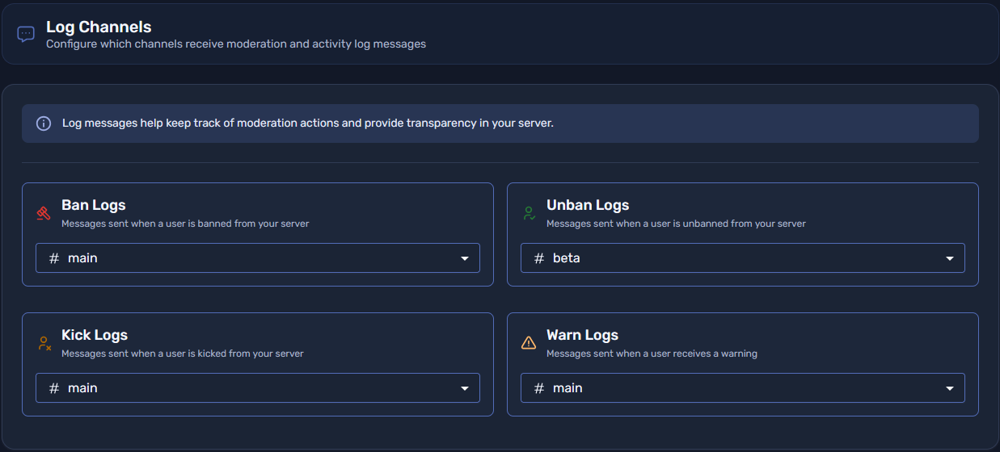

# Log Channels

Choose where Realm Bot posts bans, unbans, kicks and warnings in Discord.

---

> **Best Practice:** Keep log channels **staff-only** and **read-only** for most roles. Avoid using public channels for moderation logs.

---

## How to Configure

1. Create (or choose) one or more staff-only Discord channels, for example:
   - `#mod-logs`
   - `#staff-commands`
   - `#audit-log`

2. In **Log Channels**, select the destination channel for each log type:
   - Ban Logs
   - Unban Logs
   - Kick Logs
   - Warn Logs

3. Ensure Realm Bot has the required permissions in each selected channel:
   - **View Channel**
   - **Send Messages**
   - **Read Message History** (recommended)

> **If logs are not posting:** the first thing to verify is channel permissions.

---

## Recommended Channel Structure

### Option A - Single Consolidated Log Channel (Simple)
Route all log types to one channel, such as `#mod-logs`.  
This is appropriate for smaller teams and lower activity.

### Option B - Split by Severity (Recommended for Staff Teams)
- `#warnings-and-kicks` → Warn Logs + Kick Logs  
- `#ban-and-unban` → Ban Logs + Unban Logs  

### Option C - Full Separation (High Activity)
Use separate channels for each log type.  
This is most suitable for large servers with frequent moderation activity.

---

## Operational Notes

- Ensure senior staff can review logs even if moderators cannot delete or edit messages.
- If your server is using multiple Realms, keep your log structure consistent across them to reduce staff confusion.

---
