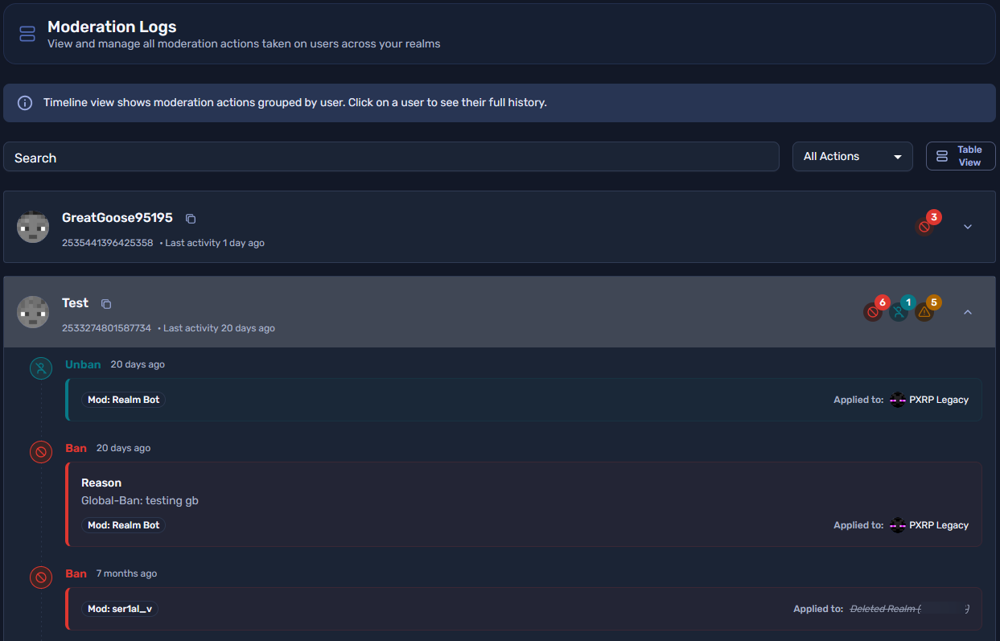

# Moderation Logs

Use **Moderation Logs** to review bans, kicks, warnings and reversals across your connected Realms.

---

## Timeline View

By default, Moderation Logs use a **timeline view** that groups actions by user.

- Each user row shows:
  - gamertag / identity
  - a unique identifier (e.g., XUID where available)
  - last activity timestamp
  - a count indicator for logged actions

- Expand a user to view their full action history, including:
  - action type (e.g., Ban)
  - date/time of the action
  - moderator responsible
  - reason text (if provided)
  - realm the action was applied to

---

## Search & Filtering

### Search
Search for a player to review their previous actions and reasons.

### Action Filter
Select a type in **All Actions** to show only bans, kicks, warnings or reversals.

---

## Table View

Use **Table View** to compare recent actions across players rather than opening each player's timeline.

---

## Best Practices

- **Require reasons for major actions.** A consistent reason standard improves future moderation decisions and appeals.
- **Review logs routinely.** Weekly checks help catch misuse or inconsistencies early.
- **Use logs for escalation.** A repeat pattern visible in the timeline is often the clearest justification for longer bans or permanent removal.

---

## Notes on Accuracy and Visibility

- Moderation Logs reflect actions issued through Realm Bot and associated systems.
- If your staff use additional in-game-only moderation, those actions may not appear unless they are executed through Realm Bot workflows.

---
