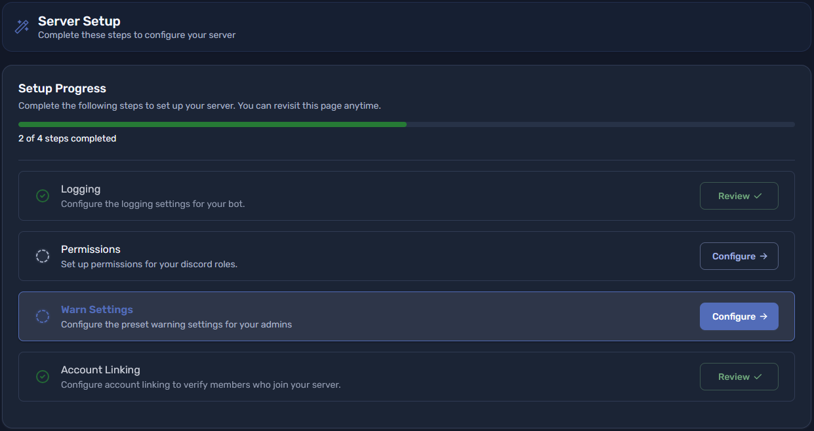

# Server Setup

Use **Server Setup** to configure moderation and member verification for your Discord server.

---

## Setup Steps

Select **Configure** for an incomplete step or **Review** to change an existing setting.

1. **[Logging](server-logs.md):** Choose staff-only channels for moderation logs and give Realm Bot permission to post there.
2. **[Permissions](server-permissions.md):** Grant each Discord role only the commands it needs. Reserve management actions for trusted staff.
3. **[Warn Settings](server-warnings.md):** Set warning reasons and ban thresholds to match your server rules.
4. **[Account Linking](server-account-linking.md):** Check the Discord and Microsoft/Xbox accounts before enabling verification or automatic invitations. Use only trusted accounts for administrative access.

---

## Updates Channel

This optional setting is on the server's **Overview**, not one of the setup checklist steps. Use it to receive Realm Bot's published patch notes, feature alerts and announcements in Discord. Premium is not required.

1. Grant Realm Bot **Manage Webhooks** in the intended Discord text or announcement channel.
2. Open **Overview > Bot Updates & Announcements** and choose **Select updates channel**.
3. Choose the channel and select **Subscribe Channel**. To move the subscription, use **Update Channel**. To stop it, use **Remove > Confirm Remove**.

When Realm Bot joins a server with a designated Discord **Community Updates** channel, it attempts to subscribe that channel if the announcement source is configured and the bot has permission. If it was not subscribed, set it up manually. Dismissing the setup prompt does not unsubscribe a channel.

If two channels receive posts after a move, the new subscription may have succeeded while removal of the old one failed. Remove the stale follower in the old channel's **Settings > Integrations**, or restore **Manage Webhooks** and retry.

---

## Troubleshooting

### A step shows as incomplete after configuration
- Open the incomplete step and check its required settings.
- Ensure Realm Bot has the required Discord permissions for the feature (especially for logging).

### Review buttons work, but modules still fail
Server Setup covers foundational configuration. Some Realm modules additionally require:
- Realm-specific configuration (inside the Realm dashboard)
- A Relay Account to be in-game (for certain modules)
- Gametest Pack dependencies (for advanced Realm features)

---
