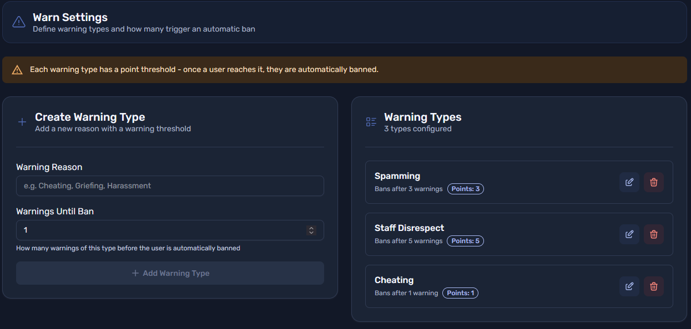

# Warn Settings

The **Warn Settings** page allows you to define structured **warning types** for your server. Each warning type has:

- A **reason** (what the warning represents)
- A **Warnings Until Ban** threshold (how many times that warning type can be issued before an automatic ban)

---

## How the Warning System Works

Warnings are organised by **type**. When a staff member issues a warning of a given type (e.g., *Spamming*), Realm Bot records it against the user.

The configured **Warnings Until Ban** value determines the automatic escalation point:

- If **Warnings Until Ban = 3**, the user will be banned after receiving **three warnings of that type**
- If **Warnings Until Ban = 1**, a single warning of that type triggers an immediate ban (use sparingly)

> **Operational Note:** Warning thresholds apply per warning type. This allows you to treat different behaviours with different severity (e.g., spamming vs cheating).

---

## Creating a Warning Type

Open **Create Warning Type** and set the following fields.

### Warning Reason
Enter a short reason that matches a server rule.

Examples:
- `Spamming`
- `Harassment`
- `Staff Disrespect`
- `Cheating`
- `Inappropriate Language`

**Best practice:** Keep reasons short, clear, and consistent with your server rules.

### Warnings Until Ban
The number of warnings of this type required before an automatic ban is applied.

Suggested thresholds:
- **1** - Severe behaviours (e.g., cheating, doxxing threats, extreme harassment)
- **3** - Moderate behaviours (e.g., spamming, repeated minor disruption)
- **5** - Lower severity behaviours (e.g., minor disrespect, low-level nuisance)

When ready, select **Add Warning Type** to create it.

---

## Managing Warning Types

Find the warning type by its reason and threshold, then choose an action:
- **Edit** (pencil icon) - change the reason or threshold
- **Delete** (trash icon) - remove the warning type

> **Important:** If you delete a warning type, update the staff guidance that refers to it.

---

## Recommended Moderation Design

### Keep the List Small and Meaningful
Aim for warning types that map directly to your rule categories. Too many types slows staff down and makes enforcement inconsistent.

A practical baseline for most servers:
- Spamming (3)
- Harassment (2–3)
- Staff Disrespect (5)
- Cheating (1)
- Inappropriate Content (1–2)

### Align Thresholds with Rule Severity
Set thresholds based on the harm level:
- Immediate ban for “zero tolerance” rules
- Multi-strike for behaviour that can be corrected

### Write Staff Guidance
Tell staff:
- which warning types to use for common situations
- what evidence is required for severe types (e.g., cheating)

---

## Troubleshooting

### Automatic bans feel too aggressive
- Increase **Warnings Until Ban** for the relevant warning type
- Split overly broad warning types into “minor” vs “severe” categories (only if necessary)

### Staff are issuing inconsistent warning reasons
- Reduce the number of warning types
- Rename warning reasons to match your rules exactly
- Provide staff examples of which type to use for each scenario

---
