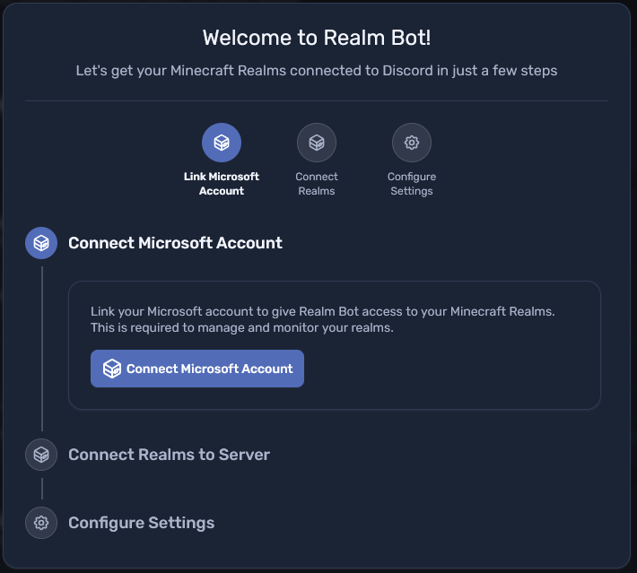

# Getting Started

Link your Microsoft account, connect its Realms to your Discord server, then choose the modules you want to use.

---

## Before You Begin

### 1) Invite Realm Bot to Your Discord Server
Realm Bot must be present in your Discord server before you can run the connection command.

- Use the `/invite` command **or** invite via: https://realmbot.dev/invite
- Grant the required permissions. **Administrator** is recommended for full functionality.

> **Important:** If Realm Bot cannot post messages or cannot read channels where you plan to use features (logs, chat relay, leaderboards), setup may succeed but modules will not operate correctly.

### 2) Ensure You Have the Correct Access
You should be:
- The Realm Owner, or a trusted administrator with access to manage the Realm
- The Discord server owner or an **Administrator** to select the server in the dashboard. **Manage Server** alone is not sufficient.

---

## Step 1 - Link Your Microsoft Account

Link the Microsoft/Xbox account that manages the Realms you want to connect.

1. Go to the dashboard: https://dashboard.realmbot.dev
2. Sign in with Discord.
3. Select **Connect Microsoft Account** to link your Microsoft/Xbox account.

> **Security Note:** Only link an account you trust to administrate the Realm. Treat account linking as privileged access.

---

## Step 2 - Connect Your Realms

> **Warning:** Check the selected Discord server and Xbox account before connecting. If a returned Realm is already associated with another Discord server, connecting **moves** its association, disables its Realm Bot modules and clears their configurations. Record any settings you need to keep. This does not transfer ownership in Minecraft.

Choose **one** route. Both refresh the Realms associated with your linked Xbox account:

- **Dashboard:** Select the intended server. After **Connect Microsoft Account**, select **Connect Realms**. On a server with no connected Realms, the same action is available from **Server Overview > Connect Realms**.
- **Discord:** In the intended server, run [`/connect`](Commands/Utility/connect.md) in a channel where Realm Bot can respond. If someone referred you, you can enter their code in the optional `referral_code` field. See [Referrals](Tools/referrals.md) for eligibility.

Confirm that the expected Realms appear in the server dashboard before configuring modules.

---

## Step 3 - Configure Your Realm Settings

1. **Choose your Realm** (if prompted)
2. Review **Bot Join Settings** (how the relay/bot connects)
3. Configure **Gametest Pack Management** (only if required by your modules)
4. Enable the features you need in [Realm Modules](<Realm Modules/overview.md>). If you use a Tebex store, follow [Tebex setup](Integrations/tebex.md).

For command help in Discord, run `/help`.

---

## Common Issues

### “I can’t see my Realms in the dashboard.”
- Confirm you linked the correct Microsoft/Xbox account.
- Ensure the account actually owns (or has access to) the Realms you expect.
- Re-open the dashboard and refresh after linking.

### `/connect` does nothing or fails.
- Realm Bot is invited to the server and is online.
- You are running `/connect` in a server channel where the bot has permission to respond.
- Your role has sufficient permissions to run management commands (server admin recommended).

### Xbox/Microsoft privacy blocks linking or access.
Check whether the linked Xbox account's privacy settings allow access to the required profile and Realm information, then retry.

---

## Next Steps

- Open the [Realm Modules Overview](<Realm Modules/overview.md>) to configure features.
- Review [Relay Account and GameTest Dependencies](<Realm Modules/relay-account-and-gametest.md>) before enabling live or GameTest-dependent modules.
- Configure [Permissions](<Server Dashboard/server-permissions.md>) and Discord channel access before giving staff operational control.
- Use [Troubleshooting](Troubleshooting/private-title-history.md) when an automated entry check reports private title history.
